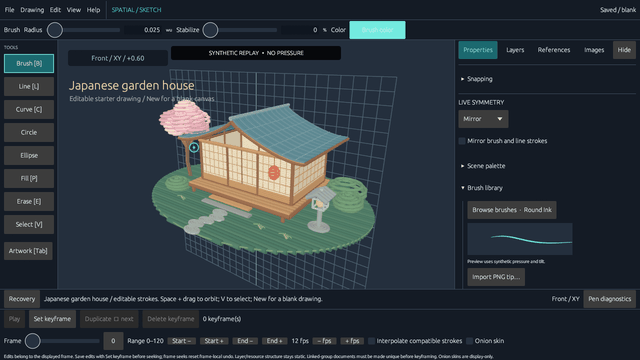
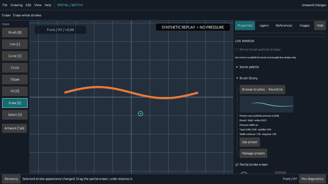
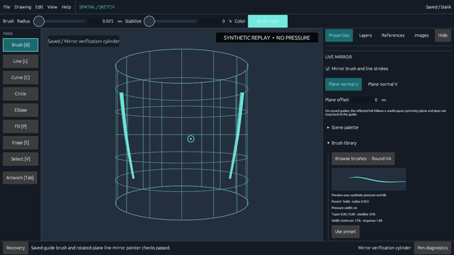
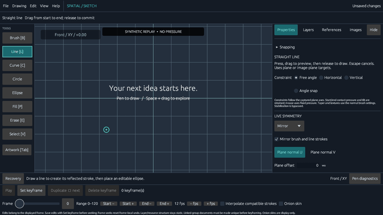
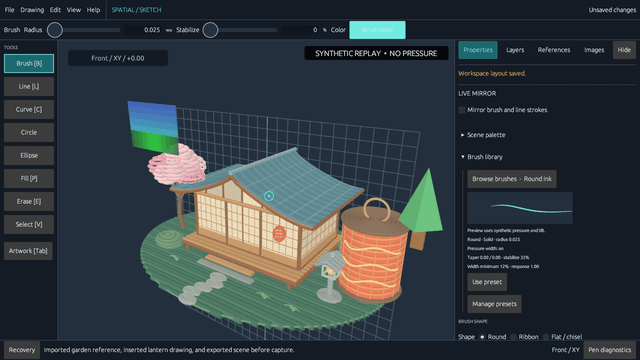

# Sketch3D

Sketch3D is an open-source, tablet-first 3D sketching app written in Rust. Draw editable strokes in space, work on flat or curved guides, and export artwork for other tools.

Sketch3D is independently developed and inspired by Feather 3D and Blender's Grease Pencil.


*The editable garden-house starter scene, shown in an earlier-build demo capture.*

## Features

- Pressure-sensitive 3D brush strokes with stabilization, editable brushes, and undo/redo.
- Procedural graphite and charcoal brushes with pressure opacity, tilt broadening, and a manual fallback.
- Stipple and spray brushes with reproducible spacing, bounded planar scatter, and pressure response.
- Freely placed drawing planes and curved guides, including cylinders, revolved surfaces, and saved custom guides.
- Selection, transforms, groups, layers, fills, shapes, curves, mirroring, and partial erasing.
- Image planes and OBJ references for drawing over references or onto model surfaces.
- Automatic recovery and a local drawing library for organizing native drawings.
- Artwork image, OBJ, and GLB exports, plus animated GIF and MP4 exports.

Native pen backends are implemented for Windows Ink, Linux XInput2 on X11, Linux tablet-v2 on Wayland, and macOS AppKit. Linux and macOS cross-target checks pass, but their runtime event-loop behavior has not been verified. Physical tablet behavior has not been verified on any platform; mouse drawing remains available when native pen setup fails or is unavailable.

## Run

Install stable Rust from [rustup.rs](https://rustup.rs). Windows builds also require Visual Studio Build Tools with the Desktop development with C++ workload and a Windows SDK.

```sh
cargo run --release
```

The app opens with an editable Japanese-style garden house. Choose **New** for a blank drawing or run `cargo run --release -- --blank` to start blank. Run with `--demo` to open the original three-ring geometry example.

On Debian/Ubuntu, install the development packages used by winit, Wayland/X11, and the file-dialog backend: `build-essential pkg-config libxkbcommon-dev libwayland-dev libx11-dev libxi-dev libxcursor-dev libxrandr-dev libxinerama-dev libvulkan-dev libdbus-1-dev`. On macOS, install Xcode Command Line Tools.

## Tablet setup

Sketch3D attempts to install the native pen listener when the application window starts. The Input lab reports whether setup succeeded; if it fails, mouse drawing remains available.

- **Windows:** uses Windows Ink. Install the tablet manufacturer's driver and enable **Windows Ink** in its application profile.
- **Linux on X11:** uses XInput2 tablet valuators.
- **Linux on Wayland:** uses the stable tablet-v2 protocol. The compositor must expose that protocol; otherwise native pen setup is unavailable and drawing falls back to mouse input.
- **macOS:** uses AppKit tablet events.

Map the tablet to the intended monitor and preserve the correct aspect ratio. Sketch3D receives driver-mapped coordinates and does not provide its own tablet calibration. Linux and macOS backends are compile-checked, but their compositor/runtime event flow is unverified. Physical-device behavior remains unverified on all platforms.

Draw in the central canvas. The Input lab reports pen samples, pressure, and tilt. If it shows **WAITING FOR PEN**, input is arriving as mouse input and pressure is unavailable. Unsupported tilt is shown as not reported. Mouse drawing uses constant pressure.

## Essential controls

| Action | Input |
| --- | --- |
| Brush / erase / select | B / E / V |
| Move / rotate / scale selection | G / R / S |
| Add or remove a stroke from selection | Shift-click |
| Duplicate / delete | Ctrl/Cmd+D / Delete |
| Orbit / pan / zoom | Space+drag / Space+Shift+drag / Space+Alt+drag; right / middle mouse drag and wheel also work |
| Align view to guide / create plane from view | F / Shift+F |
| Undo / redo | Ctrl/Cmd+Z / Ctrl/Cmd+Shift+Z |
| Save / save as | Ctrl/Cmd+S / Ctrl/Cmd+Shift+S |
| Open / new drawing | Ctrl/Cmd+O / Ctrl/Cmd+N |

The **Help** menu and in-app tutorial describe the drawing tools and workflows. Essential controls do not require touch. An edge-on drawing plane cannot accept strokes; press F to align the view or orbit away from the edge.

To refine an ordinary stroke, select it with **V** and choose **Edit points…** in the top toolbar. Click and drag its point handles in the view plane, or enter coordinates in the inspector. **Apply point edits** commits the session as one undo step; **Cancel point edits** or **Escape** discards it. The preview shows the edited centerline over the committed stroke. Handles include points behind artwork; orbit to inspect depth. Canvas editing supports up to 4,096 samples and excludes fills, semantic curves, and linked groups.

## Capability gallery

Click a preview to open its captioned MP4. These deterministic current-build replays use synthetic input without pressure data; they do not measure tablet pressure or latency. GIF previews play once, and the longer ones are accelerated six-second summaries. Key-frame, caption-timing, hash, size, and privacy checks are complete; full-motion readability at native video size and rendered README-surface review remain pending.

| Overview | Draw and orbit | Partial erase and undo |
| --- | --- | --- |
| [](docs/capability-demos/media/overview.mp4) | [](docs/capability-demos/media/draw-orbit.mp4) | [](docs/capability-demos/media/edit-erase.mp4) |
| An 18-second overview with a production selection transform, undo/redo, and GLB export options. | Drawing through the canvas handler, followed by a camera orbit. | Live selection and appearance editing, partial erase, undo, and orbit. |

| Curved guides | Mirror and shapes | References and scene export |
| --- | --- | --- |
| [](docs/capability-demos/media/curved-guides.mp4) | [](docs/capability-demos/media/mirror-shapes.mp4) | [](docs/capability-demos/media/reference-export.mp4) |
| Draw a mirrored stroke across a saved cylinder, then orbit. | Draw the mirrored line and ellipse through production handlers. | Run the production OBJ Import control with a generated picker result, insert through native merge, then export the scene. The native picker and preview dialog are not shown. |

Posters, captions, file hashes, source commits and capture manifests accompany the clips in the [media index](docs/capability-demos/media/README.md). Written tutorials and native sample documents are below.

| Workflow | Recording | Static tutorial | Editable fixture |
| --- | --- | --- | --- |
| Explore and edit a curved drawing | [](docs/capability-demos/media/curved-tutorial.mp4) · [WebVTT](docs/capability-demos/media/curved-tutorial.en.vtt) | [Static steps and transcript](docs/capability-demos/tutorials/curved-drawing.md) | [Captured native sample](docs/capability-demos/media/curved-tutorial-saved.sketch.json) · [Cylindrical lantern](docs/capability-demos/fixtures/cylindrical-lantern.sketch.json) |
| Select, transform, and save a scene | [](docs/capability-demos/media/house-tutorial.mp4) · [WebVTT](docs/capability-demos/media/house-tutorial.en.vtt) | [Static steps and transcript](docs/capability-demos/tutorials/house-editing.md) | [Captured native sample](docs/capability-demos/media/house-tutorial-saved.sketch.json) · [Garden house](docs/capability-demos/fixtures/garden-house.sketch.json) |

See the [recording workflow](docs/capability-demos/README.md) and [shot list](docs/capability-demos/shot-list.md) for action coverage, prerequisites, provenance, and review limits. Tutorial GIFs are accelerated previews; use the MP4 with its VTT captions for normal-speed instruction.

## Drawings and exports

Native drawings use the editable `.sketch.json` format. Image and model references are copied into managed asset folders alongside the drawing. Sketch3D also supports PNG/JPEG artwork images, OBJ meshes, GLB scenes, and animated GIF/MP4. MP4 export uses FFmpeg with libx264 when available, then falls back to Blender's H.264 video encoder.

Recovery snapshots protect completed edits separately from deliberate drawing saves. Use **Save** to create or update your native drawing file. Camera bookmarks, view sequences, and local brush settings are stored separately from drawings.

## Releases

After setting the version in `Cargo.toml`, push the matching tag (for example, `v0.1.0`) to build Windows, Linux, and macOS archives and publish them with generated release notes and SHA-256 checksums. The workflow marks tags containing a hyphen, such as `v0.2.0-rc.1`, as prereleases.

## Project information

- [Architecture notes](ARCHITECTURE.md)
- [Contribution guide](CONTRIBUTING.md)
- [License](LICENSE) — GPL-3.0-or-later
