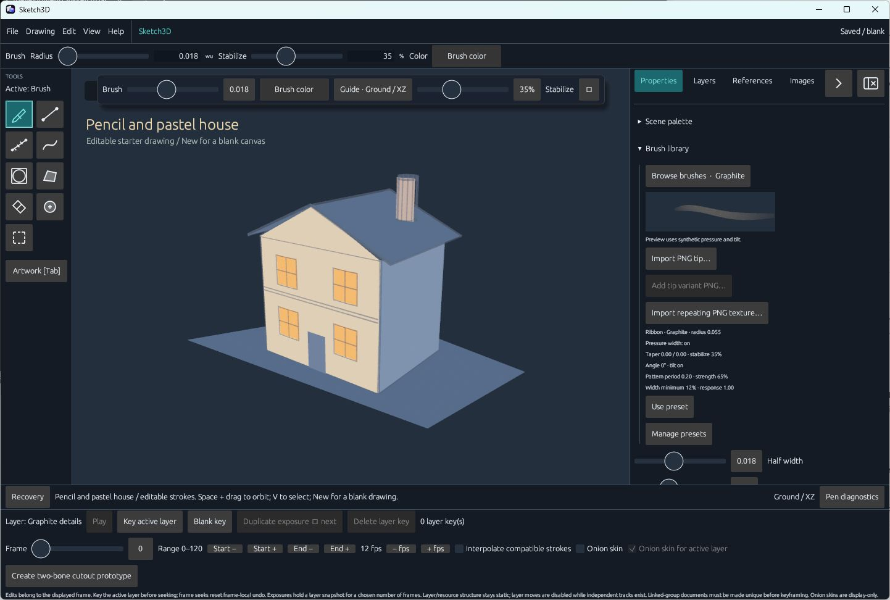
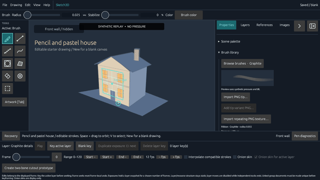
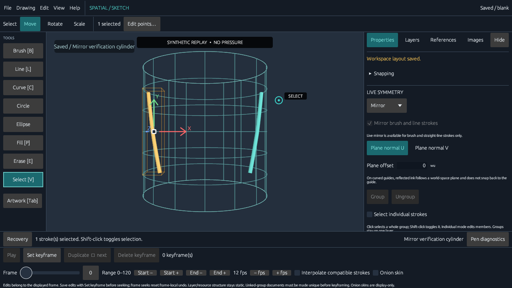
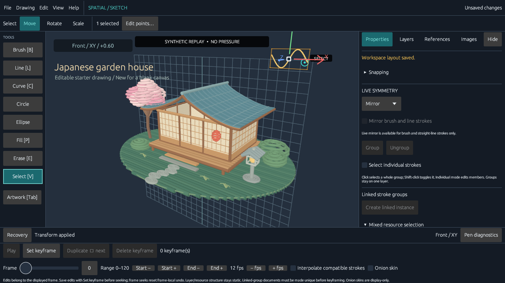

# Sketch3D

Sketch3D is an open-source, tablet-first 3D sketching app written in Rust. Draw editable strokes in space, work on flat or curved guides, and export artwork for other tools.

Sketch3D is independently developed and inspired by Feather 3D and Blender's Grease Pencil.



*Default workspace on the bundled pencil-and-pastel house, with canvas brush controls and the Properties inspector open. Captured from the Windows debug build at revision `c6e4b7c`.*

## Features

- Pressure-sensitive 3D brush strokes with stabilization, editable brushes, and undo/redo.
- Procedural graphite and charcoal brushes with pressure opacity, tilt broadening, and a manual fallback.
- Stipple and spray brushes with reproducible spacing, bounded planar scatter, and pressure response.
- Freely placed drawing planes and curved guides, including cylinders, revolved surfaces, and saved custom guides.
- Canvas picking for saved guides. New ink can follow saved planes, cylinders, freeform sheets, lofts, and imported OBJ meshes.
- Selection, transforms, groups, layers, fills, shapes, curves, mirroring, and partial erasing.
- Trim and extend strokes at planar intersections, or redraw a section between two joins.
- Enclosed fills and seed-based refresh on planes, saved cylinders, and supported OBJ patches. Scope boundaries by layer or use temporary closing guides on planes and cylinders.
- Editable hatch strokes for planar and cylinder fills, with adjustable angle and spacing for crosshatching.
- Layer masks with named sources that survive reordering and an option to invert coverage.
- Planar rectangle and rounded-rectangle tools with numeric sizing, square constraint, optional fills, and editable parameters.
- Image planes and OBJ/GLB model references for tracing images, viewing embedded GLB textures, and drawing onto model surfaces.
- Automatic recovery and a local drawing library for organizing native drawings.
- A shared timeline for layer retiming, preview loops, editable in-betweens, and camera keys.
- A movable colored point light with adjustable intensity and range, plus optional local shadows.
- PNG/JPEG, OBJ, and GLB export, synchronized GIF/MP4 shot export, and editable Blender Grease Pencil handoff.

Native pen backends are available for Windows Ink, Linux XInput2 on X11, Linux tablet-v2 on Wayland, and macOS AppKit. Mouse drawing remains available when native pen setup is unavailable. Physical tablet validation is pending on all platforms.

## Run

Install stable Rust from [rustup.rs](https://rustup.rs). Windows builds also require Visual Studio Build Tools with the Desktop development with C++ workload and a Windows SDK.

```sh
cargo run --release
```

The app opens with an editable pencil-and-pastel house at dusk and a Graphite brush. The Japanese garden house is available under **File → Examples**. Choose **New** for a blank drawing or run `cargo run --release -- --blank` to start blank. Run with `--demo` to open the original three-ring geometry example.

On Debian/Ubuntu, install the development packages used by winit, Wayland/X11, and the file-dialog backend: `build-essential pkg-config libxkbcommon-dev libwayland-dev libx11-dev libxi-dev libxcursor-dev libxrandr-dev libxinerama-dev libvulkan-dev libdbus-1-dev`. On macOS, install Xcode Command Line Tools.

## Tablet setup

Sketch3D attempts to install the native pen listener when the application window starts. The Input lab reports whether setup succeeded; if it fails, mouse drawing remains available.

- **Windows:** uses Windows Ink. Install the tablet manufacturer's driver and enable **Windows Ink** in its application profile.
- **Linux on X11:** uses XInput2 tablet valuators.
- **Linux on Wayland:** uses the stable tablet-v2 protocol. The compositor must expose that protocol; otherwise native pen setup is unavailable and drawing falls back to mouse input.
- **macOS:** uses AppKit tablet events.

Map the tablet to the intended monitor and preserve the correct aspect ratio. Sketch3D uses driver-mapped coordinates. Native pen event delivery on Linux and macOS still needs runtime validation.

Draw in the central canvas. The Input lab reports pen samples, pressure, and tilt. If it shows **WAITING FOR PEN**, input is arriving as mouse input and pressure is unavailable. Unsupported tilt is shown as not reported. Mouse drawing uses constant pressure.

The pen barrel button orbits by default. To use it for temporary partial erasing, enable **Edit → Hold pen button to erase**, hold the button before touching the canvas, and lift the pen to apply the erase.

## Essential controls

| Action | Input |
| --- | --- |
| Brush / line / measure / curve | B / L / M / C |
| Fill / erase / tint / select | P / E / T / V |
| Open the quick tool and command palette | Q, then type to search. Use the arrow keys and Enter or click an item. Esc closes it. |
| Move / rotate / scale selection | G / R / S |
| Add or remove a stroke from selection | Shift-click |
| Select all / duplicate / delete | Ctrl/Cmd+A / Ctrl/Cmd+D / Delete or Backspace |
| Group / ungroup selection | Ctrl/Cmd+G / Ctrl/Cmd+Shift+G |
| Orbit / pan / zoom | Space+drag / Space+Shift+drag / Space+Alt+drag; right / middle mouse drag and wheel also work |
| Align view to guide / create plane from view | F / Shift+F |
| Pick a saved drawing guide | Shift+K, then click a visible plane grid or curved guide |
| Place a drawing plane on artwork | K, click a surface to preview, then Enter to place; Esc cancels |
| Sample artwork color | I, then click artwork; Esc cancels |
| Toggle artwork-only view | Tab |
| Undo / redo | Ctrl/Cmd+Z / Ctrl/Cmd+Shift+Z or Ctrl/Cmd+Y |
| Save / save as | Ctrl/Cmd+S / Ctrl/Cmd+Shift+S |
| Open / new drawing | Ctrl/Cmd+O / Ctrl/Cmd+N |

The **Q** palette provides tool choices, Undo/Redo, and contextual commands. The floating canvas strip provides common brush and guide controls, and a selection brings up actions such as Move and Duplicate. Choose **Shape** from the tool rail or Q palette, then choose Circle, Ellipse, Rectangle, or Rounded rectangle. The **Help** menu's **All shortcuts / help** page and the in-app tutorial describe additional workflows. Essential controls work with a mouse or pen. If a drawing plane is edge-on, press F to align the view or orbit away from the edge.

To refine an ordinary stroke, select it with **V** and choose **Edit points…** in the top toolbar. Click and drag its point handles in the view plane, or enter coordinates in the inspector. **Apply point edits** commits the session as one undo step; **Cancel point edits** or **Escape** discards it. The preview shows the edited centerline over the committed stroke. Handles include points behind artwork; orbit to inspect depth. Canvas editing supports up to 4,096 samples and excludes fills, semantic curves, and linked groups.

Use the **Shape** tool to choose Circle, Ellipse, Rectangle, or Rounded rectangle from the contextual bar. Rectangle tools work on planar guides and image planes. Drag opposite corners, or enable typed dimensions to place from a center point. Square constraint, snapping, optional fill, and corner radius are available. Select a created rectangle and choose **Edit shape…** to reopen its dimensions; Apply creates one undoable edit and Cancel preserves the original.

In the **Select** panel, use **Trim to intersection** to remove a span, **Extend to intersection** to extend an endpoint by up to one world unit, or **Redraw stroke segment** to replace a span between two picked joins. These tools work on editable sampled strokes on the active plane. Redraw supports untimed ink and blends pressure at the joins. Review the preview before applying.

### Attach ink to a surface

Activate a saved guide or select **Draw here** on an OBJ reference. In Brush properties, enable **Attach new strokes to active surface**. Attached ink follows guide or model transforms, cylinder radius changes, and compatible edits to freeform and loft controls. Attachment uses static artwork. Freeform and loft attachment supports sampled brushes without flow or stamps.

For existing sampled ink on a saved plane or cylinder, use **Attach selection to active guide** under **Saved guides**. For an OBJ, select the strokes, choose **Reproject strokes…**, pick the reference, and enable **Attach projected strokes to model**. Review the preview to see which strokes can be attached continuously. **Detach selection** leaves the ink where it is.

### Fill and hatch

Press **P** and choose **Enclosed region**. Pick **Visible layers** or **Active layer** as the boundary scope, then click inside the outline. On planes and saved cylinders, a fill session lets you add and reuse temporary closing guides. Cylinder and OBJ fills use ink attached to their respective surfaces. OBJ fills support one closed outline on a bounded, locally unfoldable patch.

Select an enclosed fill with a saved seed and choose **Refresh enclosed fill…** to preview the result of boundary edits. For a planar fill or a fill on a saved cylinder, choose **Hatch fill…**, set the angle and spacing, then apply to add individually editable strokes to the active layer. Each pass is one undo step. Hatch centerlines respect planar cutouts, and cylinder hatches follow their saved guide. Use a brush without timed airbrush flow.

In layer properties, choose a **Named mask source** and click **Apply**. The source stays linked when layers are reordered. Use **Invert mask** to show paint outside the source's coverage. **Clip to layer below** follows the current layer order. Masks use screen-space coverage for artwork rendering and are omitted from OBJ and GLB geometry.

## Capability gallery

Click a preview to open its captioned MP4. The recordings use synthetic input without pressure data. GIF previews play once, and the longer ones are accelerated six-second summaries. The dusk-house clip shows a saved-guide edit, orbit, native reopen, still export, and artwork-only ending.

| Overview | Draw and orbit | Partial erase and undo |
| --- | --- | --- |
| [](docs/capability-demos/media/overview.mp4) | [](docs/capability-demos/media/draw-orbit.mp4) | [](docs/capability-demos/media/edit-erase.mp4) |
| An 18-second overview with a production selection transform, undo/redo, and GLB export options. | Drawing through the canvas handler, followed by a camera orbit. | Live selection and appearance editing, partial erase, undo, and orbit. |

| Curved guides | Mirror and shapes | References and scene export |
| --- | --- | --- |
| [](docs/capability-demos/media/curved-guides.mp4) | [](docs/capability-demos/media/mirror-shapes.mp4) | [](docs/capability-demos/media/reference-export.mp4) |
| Draw a mirrored stroke across a saved cylinder, then orbit. | Draw the mirrored line and ellipse through production handlers. | Run the production OBJ Import control with a generated picker result, insert through native merge, then export the scene. The native picker and preview dialog are not shown. |

| Dusk house |
| --- |
| [](docs/capability-demos/media/dusk-house.mp4) |
| A 12-second saved-guide walkthrough with a native reopen and exported still. [Open the 1920×1080 artwork PNG](docs/capability-demos/media/dusk-house-still.png). |

Posters, captions, file hashes, source commits and capture manifests accompany the clips in the [media index](docs/capability-demos/media/README.md). Written tutorials and native sample documents are below.

| Workflow | Recording | Static tutorial | Editable fixture |
| --- | --- | --- | --- |
| Explore and edit a curved drawing | [](docs/capability-demos/media/curved-tutorial.mp4) · [WebVTT](docs/capability-demos/media/curved-tutorial.en.vtt) | [Static steps and transcript](docs/capability-demos/tutorials/curved-drawing.md) | [Captured native sample](docs/capability-demos/media/curved-tutorial-saved.sketch.json) · [Cylindrical lantern](docs/capability-demos/fixtures/cylindrical-lantern.sketch.json) |
| Select, transform, and save a scene | [](docs/capability-demos/media/house-tutorial.mp4) · [WebVTT](docs/capability-demos/media/house-tutorial.en.vtt) | [Static steps and transcript](docs/capability-demos/tutorials/house-editing.md) | [Captured native sample](docs/capability-demos/media/house-tutorial-saved.sketch.json) · [Garden house](docs/capability-demos/fixtures/garden-house.sketch.json) |

See the [recording workflow](docs/capability-demos/README.md) and [shot list](docs/capability-demos/shot-list.md) for action coverage, prerequisites, provenance, and review limits. Tutorial GIFs are accelerated previews; use the MP4 with its VTT captions for normal-speed instruction.

## Drawings and exports

Use the shared timeline to key the active layer, add a **Blank key**, or duplicate a held exposure. Move or copy selected keys on one layer, or use **Retime keys across layers** to preview one shift across several layers. **Loop in** and **Loop out** set a playback preview range independently of the export range. Turn on **Onion skin** to see neighboring drawings and use **Onion skin for active layer** to control which layers appear as overlays.

Choose **Hold**, **Linear**, or **Ease In/Out** for compatible layer poses. At an interpolated frame, use **Key interpolated pose as drawing** to make the pose editable. In **Shot camera**, key the current view or copy a bookmark to the playhead. Enable **Follow shot camera** to preview the shot, and use the artwork animation export to render the camera and drawing at the same frame.

Under **Local point light**, choose **Enable local light**, set its color, intensity, and range, then drag its position handle in the viewport. **Cast local shadows** enables the optional shadow pass.

Choose **File → Export → Editable Grease Pencil (.py)…** and run the exported script in Blender 4.3 or newer. The handoff preserves editable strokes, supported planar solid single-contour fills, layer keys, held exposures, blank intervals, and frame rate. The export reports limitations for holes, gradients, textures, curved fills, and compositing effects. Animated handoff uses held keys and omits the prototype rig.

Native drawings use the editable `.sketch.json` format. Image and model references are copied into managed asset folders alongside the drawing. Sketch3D also supports PNG/JPEG artwork images, OBJ meshes, GLB scenes, and animated GIF/MP4. MP4 export uses FFmpeg with libx264 when available, then falls back to Blender's H.264 video encoder.

Recovery snapshots protect completed edits separately from deliberate drawing saves. Use **Save** to create or update your native drawing file. Shot camera keys are saved in the drawing. Camera bookmarks, view sequences, and local brush settings are stored separately.

## MCP tools

Sketch3D includes local **stdio MCP servers** in the release executable. Add the executable and its arguments as a local server in your MCP client's configuration. Use a separate server entry for each mode.

```text
sketch3d --mcp-verification-server <results-directory>
sketch3d --mcp-verification-execution-server <results-directory>
sketch3d --mcp-drawing-server <native-input-directory> <glb-output-directory>
sketch3d --mcp-live-app-server
```

Build the release binary with `cargo build --locked --release`, then replace `sketch3d` and the directory placeholders with absolute paths in the client configuration. The report server reads verifier results and artifacts. The execution server additionally exposes allowlisted checks through `verification_run_check`. The drawing server provides `drawing_inspect_native`, `drawing_export_glb`, and `drawing_create_native_copy`; it does not overwrite an existing export or source drawing. Keep the report-only mode if the client only needs to review results. Each MCP client has its own configuration format; see [MCP setup, tool schemas, and verification details](docs/VERIFICATION_RESULTS.md).

Live mode opens the desktop app with a connected MCP server. A client can inspect layers and guides, list stroke summaries by layer, capture the viewport, and preview selection, color, or movement before applying. [Live MCP setup and tools](docs/LIVE_MCP.md)

## Releases

After setting the version in `Cargo.toml`, push the matching tag (for example, `v0.1.0`) to build Windows, Linux, and macOS archives and publish them with generated release notes and SHA-256 checksums. The workflow marks tags containing a hyphen, such as `v0.2.0-rc.1`, as prereleases.

## Project information

- [Architecture notes](ARCHITECTURE.md)
- [Contribution guide](CONTRIBUTING.md)
- [License](LICENSE) — GPL-3.0-or-later
