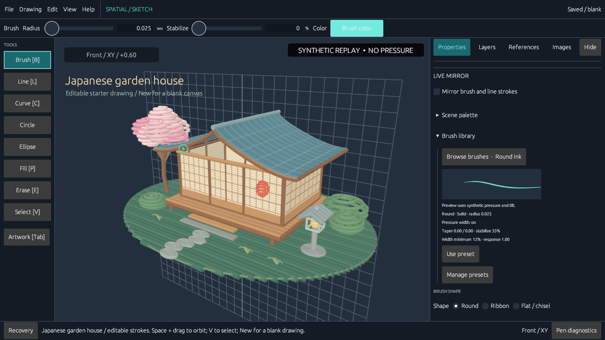
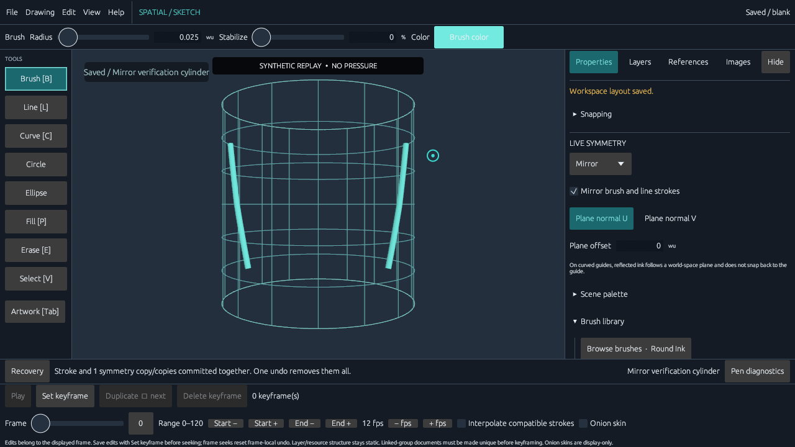
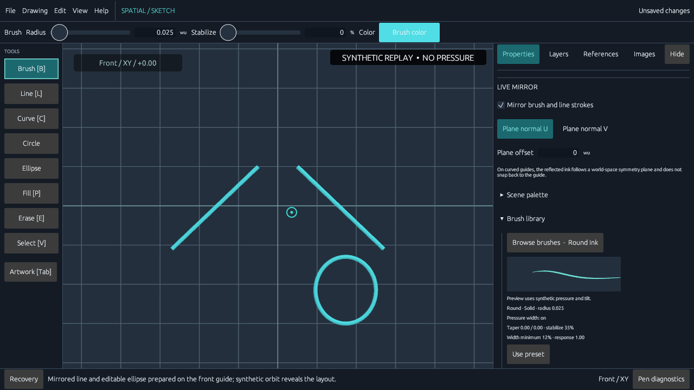
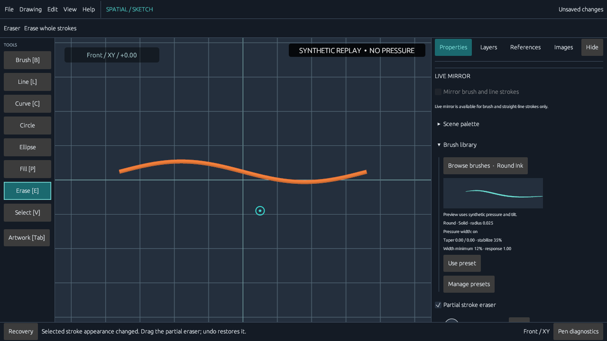
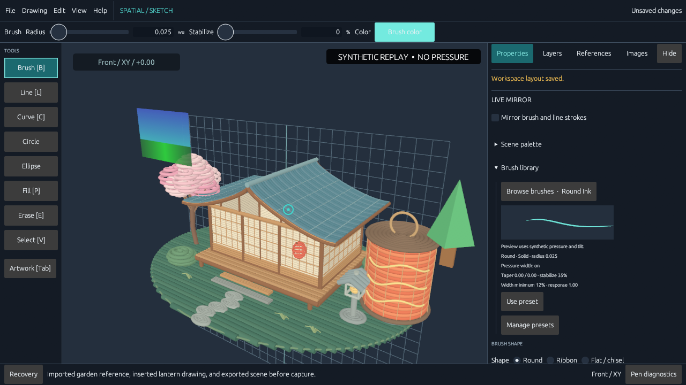
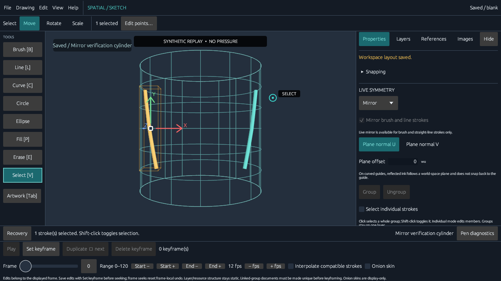
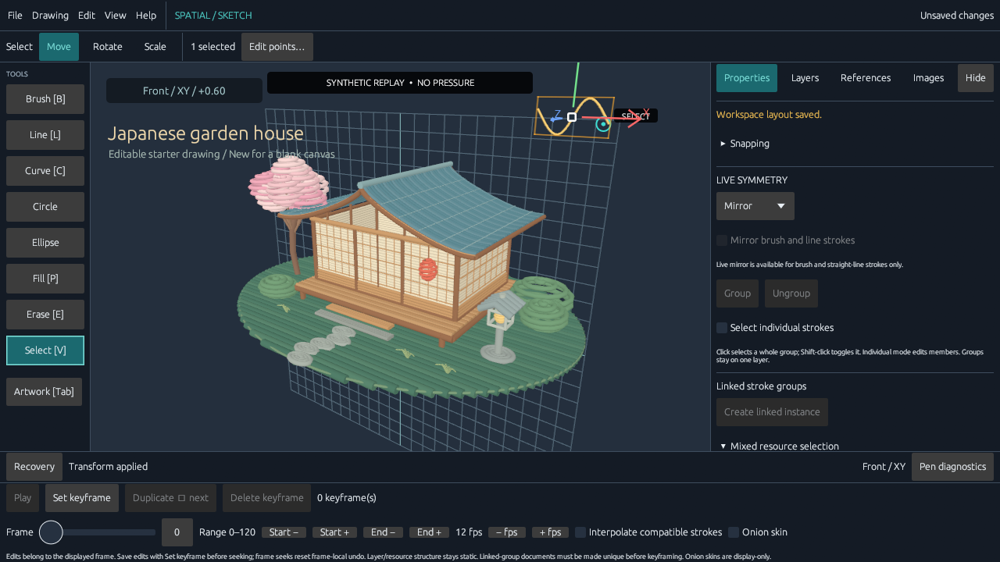
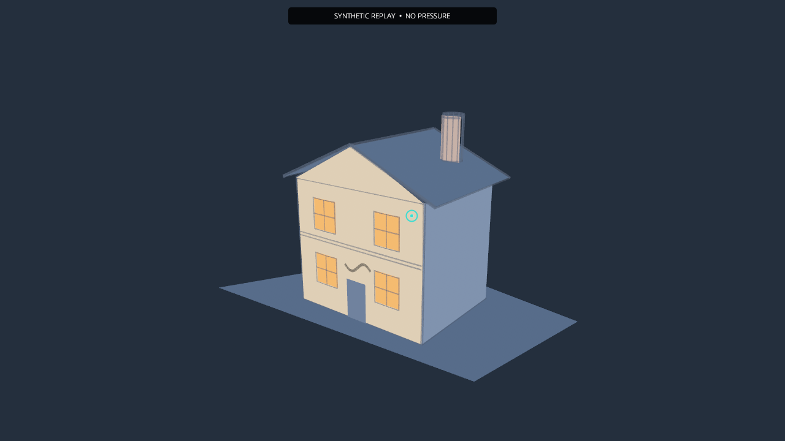

# Capability demo media

These locally curated outputs are current-build SKETCH-066 drafts. Every replay uses deterministic synthetic input with `pressure=None`; none is tablet-pressure or latency evidence. The native picker and insert-preview dialog are not shown in the reference-export clip. Hashes, size bounds, privacy scan, and caption structure have been checked; full motion/readability review at native dimensions and the rendered README surface remain pending, so the aggregate `reviewed` flag remains false.

Click any poster or GIF to open its MP4. Short clips have six-second single-play GIF previews. The overview and tutorials use accelerated six-second GIF previews; use their full captioned MP4s for normal-speed viewing. VTT captions and static tutorial alternatives are available for every instructional workflow.

| Clip | Poster / MP4 | Captions | Native sample / export | Manifest |
| --- | --- | --- | --- | --- |
| Overview | [](overview.mp4) | [VTT](overview.en.vtt) | — | [JSON](overview.recording.json) |
| Draw and orbit | [](draw-orbit.mp4) | [VTT](draw-orbit.en.vtt) | — | [JSON](draw-orbit.recording.json) |
| Curved guide drawing | [](curved-guides.mp4) | [VTT](curved-guides.en.vtt) | — | [JSON](curved-guides.recording.json) |
| Mirror and shapes | [](mirror-shapes.mp4) | [VTT](mirror-shapes.en.vtt) | — | [JSON](mirror-shapes.recording.json) |
| Selection and partial erase | [](edit-erase.mp4) | [VTT](edit-erase.en.vtt) | — | [JSON](edit-erase.recording.json) |
| Reference import and export | [](reference-export.mp4) | [VTT](reference-export.en.vtt) | [GLB scene](reference-export-scene.glb) | [JSON](reference-export.recording.json) |
| Curved drawing tutorial | [](curved-tutorial.mp4) | [VTT](curved-tutorial.en.vtt) | [Saved native sample](curved-tutorial-saved.sketch.json) | [JSON](curved-tutorial.recording.json) |
| House editing tutorial | [](house-tutorial.mp4) | [VTT](house-tutorial.en.vtt) | [Saved native sample](house-tutorial-saved.sketch.json) | [JSON](house-tutorial.recording.json) |
| Dusk house | [](dusk-house.mp4) | [VTT](dusk-house.en.vtt) | [Native sample](dusk-house-saved.sketch.json) · [1920×1080 still](dusk-house-still.png) | [JSON](dusk-house.recording.json) |

Each JSON manifest records output byte sizes and SHA-256 hashes, the app commit, capture dimensions/theme, fixture provenance, and limitations. Hashes identify the captured files; they do not mark a clip reviewed. The curation command verifies required files, size bounds, and a clean replay source tree before copying the local draft set:

```powershell
.\scripts\curate_capability_demos.ps1 -Refresh
```

The generated GIF previews use original Sketch3D scenes and scripted app actions. The reference image and OBJ in the import/export clip are procedurally generated for that replay. No outside artwork is embedded.
